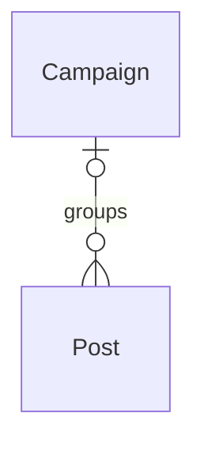

# Content calendar

*A recipe from the Fibery Process Cookbook: the process in plain words, and the model to build it in any tool.*

**Know what goes out, when, and who's writing it.** For a marketing team of two to ten. One place for every blog post, newsletter and social post, from the first idea to the published link, with campaigns to see whether a launch is on track.

## The idea

Most teams plan content in a spreadsheet and ask in chat where things stand, so nobody knows what's going out this week until someone asks. The method is simple. Every piece of content, whatever its channel, is one **Post** that moves across one board from idea to published. A calendar shows what publishes when. A post can belong to a **Campaign**, a group of posts with a shared goal and dates, like a product launch or a monthly theme, so a slipping launch is visible a week early. An **Editor** plans the calendar and approves what goes out; **Authors** write. A morning reminder replaces the "is this going out today?" message.

In any work tool, this becomes two kinds of linked records: posts whose workflow runs from *Idea* to *Published*, with *Dropped* as the other ending, and campaigns the posts link to. People live on a board of posts by state and a calendar of publish dates; a button turns approval into a comment that says who approved what for when, and a rule sends the morning reminder. It's the team's single source of truth for what gets published, not a task tracker for writers.

## How it runs

Follow one post, *Onboarding in half the time*, from idea to link.

1. **An idea is captured.** Someone adds a post in *Idea*, through the **New post** form or straight on the board: "Onboarding in half the time". They tag its **Channels**, where it goes out: *Blog*, *Newsletter*, *LinkedIn*, *X*, or the team's own list; one post often goes to several, and this one is *Blog* and *LinkedIn*. If it belongs to one, they link it to a campaign, here the Spring launch. No date yet; ideas are cheap.
2. **It gets planned.** The editor, who owns the calendar, gives it a **Publish date**, the day it goes out, its authors, the one or several people who write it, and a rough **Word count**. It appears on the **Calendar**, every post by publish date, and, once the date is within seven days, in **This week**.
3. **It gets written.** An author moves it to *Drafting*, writes in its description and attaches its **Images**, the cover and any visuals it goes out with. When the draft is ready, they move it to *In review*. The **Stage changed** rule notes the day a post is added and the day of every move, so every post shows **Days in stage**, how long it has sat where it is.
4. **It gets approved.** The editor, or whoever approves, finds it in the *In review* column of **Pipeline**, the board of every post in its state, reads it and presses **Ready to schedule**, a button on the post: it moves to *Scheduled*, and a comment records who approved it and for which date. A post scheduled without a date turns red on Pipeline until someone gives it one.
5. **The morning it goes out**, the **Publish reminder** rule tells its authors it goes out today, with the post's channels; nobody has to ask.
6. **It gets published.** The author publishes on each channel, pastes the **Link**, where the published post now lives, and moves the post to *Published*. A post published without a publish date gets today from the **Publish date on publish** rule, so the calendar and the reports stay true.
7. **Or it gets dropped.** When the team decides not to run a post, the editor moves it to *Dropped*: the board stays honest, and so do the campaign's numbers.
8. **The editor watches the campaigns.** A post whose publish date has passed and that is neither *Published* nor *Dropped* is **Late**, and its card turns red on the board. The **Campaigns** timeline shows each campaign's **Progress**, the share of its posts already published, dropped ones aside, from 0 to 100, and the **Campaign posts** grid shows its **Published posts** and **Late posts**, counts of its posts. The editor moves a campaign from *Planned* to *Running* when its first post goes out and to *Done* when its dates end. A running campaign in its last seven days with under half its posts published is **At risk** and turns red on the timeline, so the editor decides in time what to move or cut.

## What people look at

- **Every morning** — the authors of today's posts get the Publish reminder; the editor opens **Pipeline**, every post in its state, cards red when a post is late: where is every post, and in its *In review* column, what's waiting for approval.
- **Every week** — **This week**: what's due in the next seven days, and how many days each has left. **Calendar**: what goes out when, for the month.
- **Any time** — **My posts** for your own work; **Campaigns**, a timeline, for whether the launches are on track, red when one is at risk; **Campaign posts** for what's in each campaign; **Archive** for everything that went out, with its link; **New post**, a form, for intake from outside the team; and the **Output by channel** report for what actually went out, month by month.
- **How to run the content calendar** — this process on one screen, kept where the team works.

## The rules

These are all the automations; everything else in the story is done by people.

- **Ready to schedule** (a button on a post): moves the post to *Scheduled* and adds a comment that it was approved for its publish date; the comment carries the approver's name, because they pressed it. It checks nothing: a post scheduled with no date is red on Pipeline. Approval is a click that leaves a trace.
- **Publish reminder**: every day at 08:00, the authors of every post that is *Scheduled* with a publish date of today are notified, with the post's channels.
- **Publish date on publish**: when a post moves to *Published* and has no publish date, the publish date is set to today.
- **Stage changed**: when a post is created or moves to another state, its Stage changed on is set to today, which is what Days in stage counts from.

No automations in your tool? Then a person does each of these at the same moment, and the promises they keep below become practices.

## What must stay true

Whatever anyone edits, adapts or corrects, these hold; each says what keeps it so.

- ★ Every piece of content is one post on one board, whatever its channel; a channel with its own tool still gets a post here, with the link. A practice; nothing stops a second board, and a second board brings back the question of what goes out this week.
- ★ A post that is *Scheduled* or *Published* has a publish date. Shown on **Pipeline**, where a *Scheduled* post with no date is red, like a late one; kept by **Publish date on publish** for a post moved to *Published* straight from the board.
- Approval leaves a trace: who approved a post, and for which date, is in its comments. Kept by **Ready to schedule**, which writes the comment; a card dragged to *Scheduled* on the Pipeline board skips it, so approving means pressing the button.
- ★ *Dropped* is a real ending: a post the team won't run is moved to *Dropped*, not deleted and not left in *Idea*, so the board and the campaign counts stay honest. Shown by **Late**: a post past its date that is neither *Published* nor *Dropped* turns red on Pipeline and counts against its campaign until someone publishes or drops it.
- A campaign's numbers follow its posts: Published posts, Late posts and Progress count the posts linked to the campaign now, so a post moved to another campaign, or dropped, changes the counts at once. Kept by the **Published posts**, **Late posts** and **Progress** formulas.
- A slipping campaign shows before it ends: a running campaign in its last seven days with under half its posts published is red on Campaigns. Shown by **At risk**; what to move or cut is the editor's call.
- A published post is history: it stays *Published*, its publish date says when it went out, its link says where. A fix is an edit to the description or the link; a rewrite is a new post; a post that slipped a day gets its date corrected by whoever pastes the link. A practice; the Output by channel report counts what the dates say.

## Making it yours

Decide these before you set it up; each has a default if you shrug.

| Question | Default | If not the default |
|---|---|---|
| Which channels do you publish to? | Blog, Newsletter, LinkedIn, X | Posts are tagged with your own list: replace the Channels options; a channel with its own owner and cadence deserves a Channel database linked from Post instead |
| Does someone approve posts before they go out? | Yes | No: authors schedule their own posts. Drop *In review*; Ready to schedule stays, pressed by the author, so the trace stays |
| Do posts belong to campaigns? | Yes | No: nothing to watch at the campaign level. Drop the Campaign database with the Campaigns and Campaign posts views |
| Do you already track campaigns, projects or customers in your tool? | — | Posts link to what you already have: point the Campaign field at the existing database instead of a new Campaign, or add a Customer field on Post for the customer a case study is about |

- **Other words:** "Pieces", "Content", "Articles" for posts; "Launches", "Themes" for campaigns: rename freely. The calendar is the mechanics, not the vocabulary.
- **Editors as a role**, when the team wants review as a person rather than a state: an Editors field on Post, the people who review it, and a Needs my review list for them.
- **Owners for campaigns**, when several people run them: an Owner field on Campaign, the person who answers for its numbers, and a My campaigns list.
- **Different kinds of content** (a video needs a script and a thumbnail; a webinar needs a date and speakers): a Kind field on Post is usually enough; a separate database only when the stages differ too.
- **Agencies and freelancers** who don't use your tool: a Writer database linked from Post, so an outside writer is still a name on the post; Authors stays for the team's own people.
- **Distribution checklists** (repost on day 3, add to the newsletter, update the hub page): headings in the post's description first; a Task database only when the steps need owners and dates. Past that, the calendar has become a task tracker for writers, and the editor's view of what goes out gets buried.

## Details for building

What follows is what the process is built from, in words any tool can follow; the story above is enough to run it.

Each kind of record (Post, Campaign) is a database or a table, depending on the tool, or a tab in a spreadsheet. A relation links two kinds; its inverse is the name it has on the other side. A state is a step in a workflow, and a finished state ends it. A rule is an automation, a button is an automation someone presses, and a formula is a field the tool computes. A nested view shows each record's children beneath it; where a tool can't nest, group the children by their parent instead.

Each post belongs to at most one campaign, and a campaign groups any number of posts.

### Post

One record per piece of content, whatever its channel. The description holds the brief under three headings, Angle, Audience, Call to action, then the draft. Comments on.

| Field | Type | Why |
|---|---|---|
| Channels | multi select: Blog, Newsletter, LinkedIn, X | Where it goes out; one post, several channels |
| Publish date | date | What the Calendar, This week, the Publish reminder and the Output by channel report run on |
| Authors | people; inverse **Authored posts** | Who writes it, one or several; My posts and the Publish reminder go to them |
| Campaign | relation, many-to-one → Campaign; inverse **Posts** | The launch or theme it belongs to |
| Word count | integer | Rough length, set when the editor plans the post; for planning writing time |
| Images | files | The cover and any visuals the post goes out with; attached by its authors, so nobody asks in chat where the image is |
| Link | url | Where the published post lives |
| Stage changed on | date | The day the post was added or last changed state; set by Stage changed, read by Days in stage |

States: Idea → Drafting → In review → Scheduled → Published (finished) · Dropped (finished). Default: Idea. Source of truth: **Publish date**, set by people; Publish date on publish fills it only when it's empty, and a post that went out on another day gets its date corrected by hand.

Formulas:
- **Days to publish** — days from today to the publish date, a whole number, negative once the date has passed, 0 with no date; on This week.
- **Late** — yes when the publish date has passed and the post is neither *Published* nor *Dropped*, no otherwise and no with no date; colors the Pipeline cards red and is counted by Late posts on Campaign.
- **Days in stage** — days from Stage changed on to today, a whole number, 0 with no date; on the Pipeline cards.

### Campaign

One record per launch or theme: a group of posts with a shared goal and dates. The description holds the goal and the plan. Comments on.

| Field | Type | Why |
|---|---|---|
| Dates | date range | When the campaign runs; the Campaigns timeline and At risk run on it |

States: Planned → Running → Done (finished). Default: Planned.

Formulas:
- **Published posts** — how many of the campaign's posts are *Published*, a whole number, 0 with no posts; on the Campaign posts grid.
- **Late posts** — how many of the campaign's posts are Late, a whole number, 0 with none; on the Campaign posts grid.
- **Progress** — the share of the campaign's posts that are *Published*, out of those not *Dropped*, a whole number from 0 to 100, 0 when no post is left once the *Dropped* ones are out; on the Campaigns timeline and the Campaign posts grid, and read by At risk.
- **At risk** — yes when the campaign is *Running*, its Dates end in seven days or less, and Progress is under 50; no otherwise, and no with no dates; colors the Campaigns timeline red.

### Views

| View | Type | Of | Grouping | Shows | Filter | Sort |
|---|---|---|---|---|---|---|
| Pipeline | board | Post | columns State | Channels, Publish date, Authors, Days in stage; cards red when Late, or when Scheduled with no publish date | | |
| This week | list | Post | | Publish date, Days to publish, Channels, Authors, State | Publish date within the next 7 days; State is not Published or Dropped | Publish date asc |
| Calendar | calendar | Post | dates Publish date | name only; color by State | State is not Dropped | |
| My posts | list | Post | | Publish date, State, Campaign | Authors is me; State is not Published or Dropped | Publish date asc |
| Campaigns | timeline | Campaign | dates Dates | Progress; red when At risk, otherwise color by State | | |
| Campaign posts | grid | Campaign | Posts nested: State, Publish date, Channels | State, Dates, Progress, Published posts, Late posts | | |
| Archive | grid | Post | | Publish date, Channels, Link, Campaign, Authors | State is Published | Publish date desc |
| New post | form | Post | | Name (required), Channels (required), Publish date, Authors, Campaign, Description | | |
| How to run the content calendar | document | | | the process on one screen, linking to this recipe | | |

### App

None needed. The central moment is the weekly look at what goes out when, and the Calendar and the Pipeline board show it. The one thing they don't show is a channel-by-month picture, and the Output by channel report covers that.

### Reports

**Output by channel** — source Post, current, only *Published* posts: a stacked bar of posts by month of Publish date, colored by Channels.

### Sample story

The Spring launch is a week in, three weeks to go. Three of its posts went out this week, one goes out today and another in four days, and Onboarding in half the time is being drafted for next week; one launch post slipped and is still in drafting, three days past its date. Customer stories ends in five days with one of its four posts published, so it shows at risk. Holiday hub starts next month with its posts still ideas, and Summer themes ended two months ago, one of its posts dropped. Around them sit a few loose ideas, one undated, and posts waiting in review for a day to a week.

## Sources

- [7 Steps to a More Strategic Editorial Calendar](https://contentmarketinginstitute.com/content-optimization/7-steps-to-a-more-strategic-editorial-calendar), Kelsey Raymond, Content Marketing Institute, 2022: the path from topic to author, draft, edit, approval and publish date.
- [Editorial Calendar Tools and Templates To Help You Master Your Content To-Do List](https://contentmarketinginstitute.com/ai-content-creation-tools/editorial-calendar-tools-and-templates-to-help-you-master-your-content-to-do-list), Jodi Harris, Content Marketing Institute, 2022: what each entry records, from publish date and author to status and approver.
- [Blog Handbook](https://handbook.gitlab.com/handbook/marketing/blog), GitLab: an editor who approves every post and gives it its date on the calendar.

## Build it

In Fibery, open Claude with the Fibery plugin, attach this recipe and say "set up the content calendar". You'll see a one-screen design first; nothing is created until you say yes, and the build takes about ten minutes.

Anywhere else, give this recipe to your AI assistant and name your tool, or build it by hand from Details for building.

---

*From the Fibery Process Cookbook (https://github.com/Fibery-inc/process-cookbook), licensed CC BY 4.0 (https://creativecommons.org/licenses/by/4.0/): copy, adapt and build it anywhere, crediting the cookbook.*
