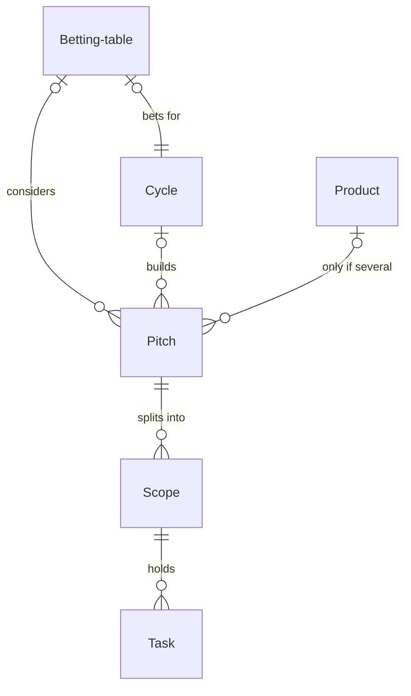

# Shape Up

*A recipe from the Fibery Process Cookbook: the process in plain words, and the model to build it in any tool.*

**Fixed time, flexible scope, no backlog.** For a product team of five to fifty. Basecamp's way of building software, set up so the rules enforce themselves. Source: https://basecamp.com/shapeup

## The idea

Most projects don't slip because teams are slow. They slip because nobody decided how much the problem was worth. Shape Up decides that first. Every piece of work is a **Pitch**: a problem with a rough solution, written at fat-marker level: rough on purpose, no fine detail. Every pitch gets an **Appetite**, a fixed amount of time, a *Small batch* of two weeks or a *Big batch* of six, and the scope flexes to fit it, never the other way round. Pitches are bet on at a **Betting table**, not scheduled. The **Team** behind a bet gets a whole **Cycle**, six weeks of building and then two of *Cool down*, with full autonomy. When the cycle ends, unfinished work stops instead of quietly stretching into next month.

In any work tool, this becomes a few kinds of linked records: pitches whose workflow runs from *Raw idea* to *Shipped*, scopes under each pitch with a hill position the owner moves every week, a board for the betting table, and a rule that stops unfinished work when the cycle ends. It's an operating system, not a task tracker: it works when the rules are fields and automations, not memory.

## How it runs

Follow one pitch, *Faster search*, through a cycle.

1. **An idea appears.** Someone notices that search is slow and writes it down as a pitch in *Raw idea*: "Faster search". Anyone can, from inside the team or through the **New idea** form. Nothing is promised yet. There is no backlog to groom.
2. **A shaper shapes it.** The **Shaper**, the senior person who turns ideas into pitches, moves it to *Shaping* and writes the pitch in its description under four headings: Problem, Solution, Rabbit holes, No-gos, then attaches its **Sketches**, the breadboards and fat-marker drawings of the solution. They set the appetite, a Big batch here, and the **Area**, the part of the product it touches. When it's ready to be judged, they move it to *Pitched*.
3. **Leadership bets.** During cool down, whoever runs the betting table, usually the CEO or the head of product, opens the next betting table, one record per betting meeting, which names the cycle it bets for: it moves from *Upcoming* to *Open*, and they put on it the pitches worth considering; not every pitch in *Pitched* gets a seat, which is why a person picks them. For each pitch worth building they press **Bet on it**: the pitch becomes *Bet*, linked to the cycle the table bets for; a pitch with no appetite shows red on the table's board, so nobody bets on one by accident. Everything else is moved to *Not bet*, and that is final; when the bets are made, the table is moved to *Closed*. An idea that comes back gets re-shaped as a new pitch, so the history of what was declined stays honest in **All pitches**, the grid of every pitch with its scopes. Faster search gets a bet.
4. **The cycle starts.** Whoever runs the betting table moves the cycle to *Building*, and the **Cycle starts** rule moves every pitch bet on it along. The team is set on the pitch, usually a designer and one or two programmers; from here on they own the whole cycle. A *Small batch* pitch doesn't get a cycle to itself: a small-batch team takes several in one cycle, one or two weeks each.
5. **The team maps the work.** In the first days the team splits the pitch into **Scopes**, demoable slices they discover while building. For Faster search: Index rebuild, Query parser, Result ranking, Search box polish. They mark the ones that are **Nice to have**, the ones that can be cut without breaking the bet; Search box polish is one. Scopes get **Tasks**, concrete to-dos written by the team, never by shapers.
6. **Every week, the dots move.** Each scope's **Owner** moves its **Hill position**, a number from 0 to 100, on the **Hill chart**, a chart shaped like a hill: the left slope is figuring things out, the top is where the approach is clear, the right slope is making it happen. A scope is *Not started* at 0, *Uphill* below 50, over the top at 50, *Downhill* while it's just work. The chart moves the scope's state with it. On Mondays the **Hill reminder** asks every owner of an unfinished scope to move their dot. A dot that stays uphill for two weeks is the signal of an unsolved unknown, and the shaper should look.
7. **Scope hammering.** With under two weeks left and the pitch behind, the team cuts nice-to-have scopes and tasks first. Search box polish goes. Appetite doesn't move; scope does.
8. **It ships, or it stops.** When the last scope is *Done*, the **Auto ship** rule moves the pitch to *Shipped*. When whoever runs the betting table moves the cycle to *Cool down*, the **Circuit breaker** rule moves every pitch in it that isn't shipped to *Stopped*: unfinished work is re-shaped, not extended. A bet that didn't ship stops; it can be re-pitched, never prolonged.
9. **Cool down.** Two weeks: bugs, small things, breathing. The next betting table happens here, and the loop starts again.

## What people look at

- **Every morning** — **Current cycle**: every scope of every building pitch, grouped by pitch, column by hill stage. Where is everything, today.
- **Every Monday** — the **Hill chart**, a custom view drawn as a hill: owners move their dots, and the Hill reminder nudges those who haven't. If your tool can't draw it, **Hill positions** does the job as a plain grid.
- **While shaping** — **Shaping board**: what's being shaped, and by whom.
- **At the betting table** — **Bets**: the pitches on the table, by appetite, with their shaper, problem and area. Afterwards, **Cycles**: what's planned, building and done.
- **Any time** — **My tasks** for your own to-dos; **All pitches** for the whole picture, every pitch with its scopes, filtered to *Shipped* for what got done or to *Not bet* and *Stopped* for what wasn't bet or didn't ship; **New idea**, a form, for ideas from anyone; the **Cycle review** report for how many bets shipped, per betting table; and **Where cycles go**, a report of which parts of the product each cycle built.
- **How to run Shape Up** — this process on one screen, kept where the team works.

## The rules

These are all the automations; everything else in the story is done by people.

- **Bet on it** (a button on a pitch): moves the pitch to *Bet* and sets its cycle to the one its betting table bets for. It checks nothing: a pitch with no appetite is red on the Bets board, and a pitch on no table has no cycle to get. Betting is a click, not a spreadsheet.
- **Cycle starts**: when a cycle moves to *Building*, every pitch linked to it that is *Bet* moves to *Building*.
- **Auto ship**: when a scope becomes *Done* and every scope of its *Building* pitch is done, the pitch moves to *Shipped* and Shipped on is set to today.
- **Circuit breaker**: when a cycle moves to *Cool down*, every pitch linked to it that is *Bet* or *Building* moves to *Stopped*. Unfinished work is re-shaped, not extended.
- **Hill reminder**: every Monday at 09:00, each owner of a scope that isn't *Done* in a building pitch is notified, one message per scope, asking them to move their dot on the Hill chart.

No automations in your tool? Then a person does each of these at the same moment, and the promises they keep below become practices.

## What must stay true

Whatever anyone edits, adapts or corrects, these hold; each says what keeps it so.

- ★ A pitch is bet only with an appetite, and a bet names its cycle. Shown on **Bets**, where a pitch with no appetite is red; kept by **Bet on it**, which sets the cycle from the table. A card dragged into *Bet* on the board gets no cycle, so betting means pressing the button; that part is a practice.
- ★ Once bet, the appetite is fixed and the scope flexes. Shown by **Hammer time** on the All pitches grid: it flags a building pitch that is behind with under two weeks left, so the cutting starts in time; the cutting itself is the team's.
- ★ The hill is the truth about a scope: Hill position and State agree. Kept by the **Hill chart**, which sets the state from the position; a card moved on the Current cycle board is overruled by the next drag.
- A pitch is *Shipped* only when every scope is *Done*. Kept by **Auto ship**. A scope reopened after shipping doesn't un-ship the pitch; the team decides whether it's a cool-down fix or a new pitch.
- ★ Nothing outlives its cycle: when the cycle ends, what didn't ship is *Stopped*. Kept by the **Circuit breaker**. A stopped pitch is re-shaped as a new pitch, never reopened; that part is a practice.
- Dots move every week. A practice; the **Hill reminder** asks every Monday, nothing enforces it.

## Making it yours

Decide these before you set it up; each has a default if you shrug.

| Question | Default | If not the default |
|---|---|---|
| One product or several? | One | Add Product, linked from Pitch, and a Product row on Bets |
| How many weeks per cycle? | 6 | Cycles get that length; three weeks is the floor, below that it's a sprint |
| Do you already track products in your tool? | — | Link Pitch to the products you already track instead of creating Product |

- **Small team (five or fewer):** drop the Betting table; put a Bets decided date on the cycle and hold the meeting in the cycle's description. Bet on it then only moves the pitch to *Bet*, and whoever bets sets its cycle by hand, so a bet still names its cycle; the Bets board loses its rows.
- **An existing task list:** leave it alone; give Shape Up its own Task and point to the old one from How to run Shape Up.
- **Other words:** "Bets" for pitches, "Initiatives", "Projects": rename freely. Shape Up is the mechanics, not the vocabulary.
- **Areas:** Area's options are a start (Core, Billing, Mobile, Integrations); replace them with the parts of your own product, or link Pitch to the components you already track instead.
- **Four-week cycles:** fine; keep the reasoning in How to run Shape Up (long enough to finish something real, short enough to feel the deadline from day one). Refuse to go below three.
- **What teams add once it runs:** a My scopes list for each owner, a report of how scopes moved up the hill over a cycle, a reminder for pitches waiting in *Pitched*. Each is small, and left out so the first cycles stay simple.

## Details for building

What follows is what the process is built from, in words any tool can follow; the story above is enough to run it.

Each kind of record (Pitch, Scope, Task) is a database or a table, depending on the tool, or a tab in a spreadsheet. A relation links two kinds; its inverse is the name it has on the other side. A state is a step in a workflow, and a finished state ends it. A rule is an automation, a button is an automation someone presses, and a formula is a field the tool computes. A nested view shows each record's children beneath it; where a tool can't nest, group the children by their parent instead.

Each pitch sits on at most one betting table and is built in at most one cycle; each betting table bets for one cycle. A scope belongs to one pitch, and a task to one scope. Product exists only when the team runs several products.

### Pitch

One record per idea, from raw to shipped. The description holds the pitch under four headings: Problem, Solution, Rabbit holes, No-gos. Comments on.

| Field | Type | Why |
|---|---|---|
| Problem | text | One line on the Bets cards; the full problem is in the description |
| Appetite | single select: Small batch, Big batch; no default | Set while shaping; fixed time, flexible scope |
| Area | single select: Core, Billing, Mobile, Integrations; no default | The part of the product it touches; set while shaping; on Bets cards, and what Where cycles go colors by |
| Sketches | files | The breadboards and fat-marker drawings of the solution, attached by the shaper; what the betting table looks at beside the description |
| Shaper | person; inverse **Shaped pitches** | Who shaped it; who to ask when a scope is stuck |
| Team | people; inverse **Team pitches** | Who builds it; they own the cycle |
| Betting table | relation, many-to-one → Betting table; inverse **Pitches** | Which meeting considered it; put on the table by whoever runs it |
| Cycle | relation, many-to-one → Cycle; inverse **Pitches** | Which cycle it's built in; set by Bet on it |
| Shipped on | date | Set by Auto ship; on All pitches, so what shipped shows when |
| Product | relation, many-to-one → Product; inverse **Pitches** | Only when the team runs several products (see Making it yours) |

States: Raw idea → Shaping → Pitched → Bet → Building → Shipped (finished) · Not bet (finished) · Stopped (finished). Default: Raw idea.

Formulas:
- **Progress** — the average Hill position of the pitch's scopes, rounded to a whole number from 0 to 100, 0 with no scopes; on the All pitches grid and in Hammer time.
- **All scopes done** — yes when the pitch has at least one scope and none of them is unfinished; Auto ship fires on it.
- **Hammer time** — yes when the pitch is *Building*, its cycle has fewer than 14 days left and Progress is under 70, no when it has no cycle; the flag on the All pitches grid that says it's time to cut scope.

### Betting table

One record per betting meeting; its description holds the decisions and the reasoning. Comments on. Fields: Date (date; when the meeting is, set by whoever runs the table when they open it); Next cycle (relation, one-to-one → Cycle; inverse **Betting table**; the cycle the meeting bets for, which Bet on it copies onto every bet pitch). States: Upcoming → Open → Closed (finished). Default: Upcoming.

### Cycle

Six weeks of building plus two of cool down. No description. Fields: Dates (date range, the six weeks of building; the Cycles timeline and Days left run on it; cool down is the two weeks after it, marked by the state). States: Planned → Building → Cool down → Done (finished). Default: Planned.

Formulas:
- **Days left** — days from today to the end of Dates, a whole number, negative once the cycle is over, 999 with no dates so nothing looks urgent; on the Cycles timeline and in Hammer time.

### Scope

A demoable slice of one pitch. Comments on.

| Field | Type | Why |
|---|---|---|
| Pitch | relation, many-to-one → Pitch; inverse **Scopes** | Every scope belongs to one pitch |
| Hill position | integer, 0 to 100 | 0 not started, 50 the top of the hill, 100 done; what the owner moves each week |
| Nice to have | checkbox | Can be cut without breaking the bet |
| Owner | person; inverse **Owned scopes** | Who moves the dot |

States: Not started → Uphill → Downhill → Done (finished). Default: Not started. Source of truth: **Hill position**. The Hill chart sets State to match it (*Not started* at 0, *Uphill* below 50, *Downhill* from 50, *Done* at 100); a card moved on the Current cycle board changes only the state, and the next drag on the chart wins.

Formulas:
- **Tasks done** — how many of the scope's tasks are done, a whole number; on cards.

### Task

A to-do inside a scope. No description. Fields: Scope (relation, many-to-one → Scope; inverse **Tasks**); Assignees (people; inverse **Assigned tasks**); Done (checkbox); Nice to have (checkbox). No states.

### Product

Only when asked for: Name and a description. Its pitches come through the inverse **Pitches**.

### Views

| View | Type | Of | Grouping | Shows | Filter | Sort |
|---|---|---|---|---|---|---|
| Current cycle | board | Scope | columns State, rows Pitch | Owner, Hill position, Tasks done; Nice to have scopes grey | Pitch is Building | |
| Hill positions | grid | Scope | | Pitch, Hill position, State, Nice to have, Tasks done | Pitch is Building | Hill position desc |
| Shaping board | board | Pitch | columns State | Shaper, Appetite | State is Raw idea or Shaping | |
| Bets | board | Pitch | columns State, rows Betting table | Shaper, Problem, Area; color by Appetite, red when there is none | State is Pitched, Bet or Not bet | |
| Cycles | timeline | Cycle | dates Dates | Days left; color by State | | |
| My tasks | list | Scope | Tasks nested: Nice to have | Pitch, State | Pitch is Building; tasks: Assignees is me, Done is false | |
| All pitches | grid | Pitch | Scopes nested: Hill position, Nice to have, Owner | Appetite, Area, Shaper, Cycle, Progress, Hammer time, State, Shipped on | | State |
| New idea | form | Pitch | | Name (required), Problem (required), Area, Description | | |
| How to run Shape Up | document | | | the process on one screen, linking to this recipe | | |

### App

**Hill chart**, a page of its own. Most tools can't draw it out of the box: build it as a custom app or view where the tool allows one, or use its fallback. It shows every scope whose pitch is *Building* as a dot on a hill-shaped curve: position 0 at the bottom left, 50 at the top, 100 at the bottom right; the left slope labeled "Figuring it out", the right slope "Making it happen". Dots are colored by pitch, dashed when Nice to have, with the scope's name above; clicking the name opens the scope. Dragging a dot along the hill changes its Hill position in steps of 5 and, on release, saves it and sets the scope's State to match. With no building pitch it shows "Nothing is being built. Bet on a pitch and start a cycle." Reads: Scope Name, Hill position, Nice to have, Owner, State, Pitch; Pitch Name, State. Writes: Scope Hill position, Scope State. Fallback: the Hill positions grid.

### Reports

**Cycle review** — source Pitch, current, only pitches with a betting table: a stacked bar of pitches by Betting table, colored by state (*Shipped*, *Stopped*, *Not bet*). Grouped by Betting table because every considered pitch has one, and *Not bet* pitches never get a cycle.

**Where cycles go** — source Pitch, current, only pitches with a cycle: a stacked bar of pitches by Cycle, colored by Area. Grouped by Cycle because every bet pitch has one; each bar is what a cycle built or stopped, and its colors say where the time went.

### Sample story

Cycle 13 is two weeks in, four to go. Faster search is building: Index rebuild is done, Query parser is just over the top of the hill, Result ranking is still uphill, and Search box polish, a nice to have, hasn't started. A second big batch builds beside it, a little behind. Cycle 12 went into cool down four weeks ago with one pitch shipped and one stopped by the circuit breaker. The betting table for Cycle 14 is in five weeks, and three pitches already sit on it, one still without an appetite. Two ideas are being shaped, two more came in through the form, and one pitch from the last table wasn't bet.

## Build it

In Fibery, open Claude with the Fibery plugin, attach this recipe and say "set up Shape Up". You'll see a one-screen design first; nothing is created until you say yes, and the build takes about ten minutes.

Anywhere else, give this recipe to your AI assistant and name your tool, or build it by hand from Details for building.

---

*Shape Up is Basecamp's method, from Ryan Singer's book* Shape Up *(2019), free at basecamp.com/shapeup. This recipe describes it in its own words and isn't affiliated with Basecamp. From the Fibery Process Cookbook (https://github.com/Fibery-inc/process-cookbook), licensed CC BY 4.0 (https://creativecommons.org/licenses/by/4.0/): copy, adapt and build it anywhere, crediting the cookbook.*
