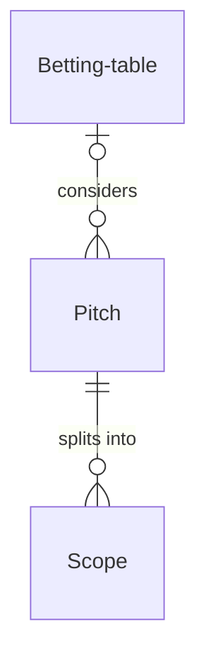

# The recipe format

A recipe has two readers and one text. A person reads it to understand how the process works and could run the process from it. A builder reads the same text to set it up: fibery-architect in Fibery, or anyone else in their own tool. That works only the way a good cookbook works: the story carries the process, the things, the roles, the states, the views people open and the rules, by the names the tables use, and the tables add the precision that makes it buildable. A person who has read the story can run the process; the tables may hold fields and formulas the story never needed to mention.

Every recipe goes into the **Fibery Process Cookbook**, an open library under CC BY 4.0 that people and agents use with any tool. So a recipe is tool-neutral: it names no tool to run the process in, Fibery included, outside its fixed texts (the italic line, Build it and the footer), and how a particular tool delivers what the recipe asks is that tool's builder's business.

One Markdown file, `<process>.md`, as long as the process needs: a metadata header, then the sections below in this order; their names are fixed so a builder finds things where they expect them. Sections 1–8 are the human half, in the order a newcomer wants them: how it works, what to look at, the rules, what must stay true, then how to make it theirs; sections 1–6 and For AI agents double as the guide a builder puts next to the work. Section 9 is the model's half, an appendix: no database, role, state, view or rule starts there, and nothing meant for the builder alone appears before it. Build it and the footer close the file.

**Names.** Every name the build will use (the things, the roles, the key fields, the states, the meetings, the views, the rules) appears in bold at its first mention, with what it is in the same sentence ("every piece of work is a **Pitch**, a problem with a rough solution"). After that it's plain text, spelled the same; bold returns only on the name a bullet is about (a rule in The rules, a view in What people look at, a case in Making it yours). Italics mark values (states, options). The bold names are the names the build uses, so the first mention is where a newcomer learns the word and where the builder learns the database list. Letters, digits and spaces only in every name ("Cool down", not "Cool-down"), so it works in any tool. A name the story introduces gets its moment later, or isn't introduced; a field a rule stamps, a date, a secondary attribute or a helper formula may appear for the first time in Details for building, where its Why says what uses it.

**The recipe's words.** The building blocks are called by the same names in every recipe, whatever tool the reader uses: database, record, field, relation, state (a workflow's steps), view with its kind (board, grid, list, timeline, calendar, map, gallery, form, document, report), rule and button (the automations), formula, app (a custom app), the guide. Never table, type, item, status or column for these, and never Workspace or Space, which are one tool's words; the fixed paragraph that opens Details for building says what each means in any tool. The team's words name their things; the recipe's words name the building blocks.

**Voice.** Recipes talk the way Fibery talks: plain words, short sentences, specific numbers, no hype. One idea per sentence; no parentheticals that exist for the builder, who has Details for building. A method's own word gets a plain gloss at first use ("fat-marker level: rough on purpose"); a mechanism the story relies on gets one sentence where it first appears; a number carries its scale ("Progress under 70 of 100", "14 days"); a database and a state that stutter ("a pitched pitch") are rephrased. Say what the process loses when pushed too far, what the recipe doesn't do, and where a choice is a common one rather than the method's. The promise is the only claim, and it's about the team, not the tool. A wink in the sample story is fine; the rules stay dry. No idiom built on record, table or field ("for the record", "table by table"): those are the recipe's words now.

## 0. Header

YAML frontmatter, the first thing in the file and the only YAML in it; search engines and builders read it, people mostly don't. Plain values, names with their capitals, short lists in brackets, `summary` in double quotes:

```yaml
---
title: Shape Up
summary: "Basecamp's Shape Up for a product team: pitches with an appetite, a betting table, six-week cycles, scopes on a hill chart, a circuit breaker."
domain: software
for: team
keywords: [shape up, basecamp, betting, appetite, hill chart, six week cycles]
version: 1
license: CC-BY-4.0
---
```

`summary` is one sentence under 160 characters, unique to this recipe: what the process is and for whom; it is what a search snippet and a skimming agent see first. `domain` is one of the cookbook's domains below. `for` is `solo`, `team`, `company` or `community`. `keywords` are the words someone would search for, including the method's own and the plain ones ("betting", "six week cycles"). `version` starts at 1 and goes up by one whenever the model changes (a database, a field, a state, a rule), never for wording. `license` is always `CC-BY-4.0`. The file name is the recipe's id; the source stays in the promise line.

**Domains.** software, product, design, marketing, sales, support, operations, management, finance, hr, legal, compliance, security, education, research, healthcare, nonprofit, community, faith, events, sports, esports, music, arts, media, hospitality, retail, manufacturing, construction, farming, household, personal. A process that fits two takes the one its people would name; a domain the list lacks is added here first, never invented in a header.

**For whom.** `for` changes the model, not just the words. `solo`: one person runs it, so there are no roles and no people fields, no "My …" views (every view is theirs), reminders go to the person, the sample story's people are the person who sets it up, and For AI agents addresses their assistant. `team`: a few people with roles; a role is a person or people field by how many people hold it, and meetings are views. `company`: several teams, approvals and hand-offs, links to the departments, products or people the company already tracks, and questions about what that is. `community`: a club, a congregation, a volunteer group, a league, where most members never open the tool: members, volunteers and players are records in a database rather than person fields, the few organizers are the person and people fields, and members come in through a form.

## 1. Title and promise

`# <Process name>`, then the same italic line in every recipe saying what a recipe is, then one bold line on what changes for whoever runs it, who it's for in a few words, and the source when there is one:

```markdown
# Shape Up

*A recipe from the Fibery Process Cookbook: the process in plain words, and the model to build it in any tool.*

**Fixed time, flexible scope, no backlog.** For a product team of five to fifty. Basecamp's way of building software, set up so the rules enforce themselves. Source: https://basecamp.com/shapeup
```

The italic line is fixed; a reader who lands on the file from anywhere learns in one line what it is. The promise is what the team gets, not what the build contains.

## 2. The idea

`## The idea`. One or two paragraphs: the problem the method answers, the principle that makes it work, the main things, the roles and the rhythm at a glance, introducing the central names in bold as they come, six names at most. For a domain process without a named method, this is what goes wrong without a system and what the lifecycle is. Close with a short paragraph that starts "In any work tool, this becomes…": two or three sentences in the recipe's words on what the process becomes, the kinds of records, the workflow, the view people live in, the rule or button that makes the method the method, and the sentence that says what kind of thing it is ("It's an operating system, not a task tracker"). It shows what a tool does for the process while describing it; the names stay the story's, and a view or rule named later in bold is described here, not named. A builder rewrites this paragraph as what it built.

## 3. How it runs

`## How it runs`. Follow one named example through its whole life ("Follow one pitch, *Faster search*, through a cycle") in numbered moments, up to ten: who picks it up, what they decide, what changes, how it ends, including the endings that aren't success. Every moment names the things by their words, defining each new one where it first appears, so the walk carries the states, roles and decisions in order. The example makes the abstract concrete for the reader; for the builder it becomes the hero record of the sample story.

Two conventions keep this half honest for the builder without marking up the prose:

- **The rules is the complete list of automations.** Anything the story describes that isn't there is done by a person, so "the shaper moves it to *Pitched*" needs no marker. An automatic step says so by naming its rule: "the **Cycle starts** rule moves every pitch bet on it along".
- **Say who does it.** Every act has a named role, introduced in bold; "someone" only where anyone may act (an idea is captured, a purchase is asked for). When the method names no role, the recipe gives it the team's plain name (the team lead), so no step belongs to nobody.

## 4. What people look at

`## What people look at`. By cadence: every morning, every week, at the meeting, any time. Each line names the views opened then (bold) and the question each one answers, in a few words; the app is named as a custom view, and the plain view that does its job where a tool can't draw it; the reports and the guide document, `How to run <process>` ("How to run Shape Up", "How to run the content calendar"), close the list. Up to eight views, the daily view first. A view that only adds a filter to another view isn't a view: people filter. The daily view and "My …" views are the exceptions. What a view shows, filters and sorts is not here; it's in the Views table of Details for building. One name, one thing: a name is a database, a field, a state, a view, a rule or a report, never two of these, so when the method uses one word for a meeting and its record, the view gets another name (the meeting is **Betting table**, the board of pitches to bet on is **Bets**; a *Shipped* state means the view is **Shipped guitars** and the rule **On shipping**).

```markdown
- **Every morning** — **Current cycle**: every scope of every building pitch, grouped by pitch, column by hill stage. Where is everything, today.
- **Every Monday** — the **Hill chart**, a custom view drawn as a hill: owners move their dots, and the Hill reminder nudges those who haven't. If your tool can't draw it, **Hill positions** does the job as a plain grid.
```

## 5. The rules

`## The rules`, opening with "These are all the automations; everything else in the story is done by people." Then the automations as policy sentences a teammate could read aloud: trigger, condition, effect, in words, one bullet each with a bold name, with no field-value syntax ("every scope of the pitch is done", not "All scopes done true") and no build notes. Say what a button is. After the list comes the fixed line "No automations in your tool? Then a person does each of these at the same moment, and the promises they keep below become practices." When the method needs no automation, the section says so in one line and stops. Up to five. Courtesy notifications don't belong here; if the story needs a nudge, it's one reminder at most.

**Simple rules only.** Every rule and button is made of what most tools' automations do without code, so the recipe works wherever it's built: on a trigger (a record created, a field changed, a record linked or unlinked, a schedule) and a condition on the record's own fields or a linked record's fields compared with fixed values, it sets a state or a value on the record or on its linked records (which of them, by a filter), creates a linked record, unlinks, adds a comment from a template, notifies the people in a field. Nothing in a recipe asks for more, and no build writes a script. So a rule never branches, compares two fields with each other, counts or searches across records, or refuses: a button does its actions whatever the record's state, and its bullet says what it's for, not what it guards. A step that would need any of that is not a rule: what it would have kept is written in What must stay true as a formula or view that shows the exceptions, or as a practice.

```markdown
- **Circuit breaker**: when a cycle moves to *Cool down*, every pitch in it that is *Bet* or *Building* moves to *Stopped*. Unfinished work is re-shaped, not extended.
```

## 6. What must stay true

`## What must stay true`, opening with the line "Whatever anyone edits, adapts or corrects, these hold; each says what keeps it so." Then up to seven bullets, the promises the process can't do without, each one in plain words, then how it is kept, in one of three ways and in these words: *kept by* a rule, a button, a formula or the app, so nobody has to remember; *shown by* a formula or a view that makes the exceptions visible (a red card, a count, a blank beside the name), so someone sees; or *a practice*, people keep it and nothing enforces it, with the reminder when there is one. Nothing refuses: a button can't check, so a promise a button would have guarded is shown or a practice. The promises are the ones the process can't do without and the ones the forward story never answers: what happens when a record is corrected, reopened, moved or entered late; what completion requires and what stays true after it; which of two things that could disagree wins. ★ marks the promises no adaptation may break, and appears nowhere else in the recipe: few stars, so each one counts. What keeps a promise is named the way The rules and Details name it, and exists there: a rule or button is in The rules, a view is in the Views table, a formula is in Details; a formula that checks a promise may appear here for the first time, with what it is in the same sentence. A promise nothing keeps is written as a practice, never left vague, and is often the moment to add the check. Nothing else starts here: no database, role, state, view or rule.

```markdown
- ★ A pitch is bet only with an appetite, and a bet names its cycle. Shown on **Bets**, where a pitch with no appetite is red; kept by **Bet on it**, which sets the cycle from the table.
- ★ The hill is the truth about a scope: Hill position and State agree. Kept by the **Hill chart**, which sets the state from the position; a card moved on the Current cycle board is overruled by the next drag.
- Dots move every week. A practice; the **Hill reminder** asks every Monday, nothing enforces it.
```

## 7. Making it yours

`## Making it yours`, opening with the line "Decide these before you set it up; each has a default if you shrug." (a builder asks them in one message before setting it up.) Then a table of up to four questions whose answers change the structure, each with a default and its effect: what to add, drop or change. The third column says the effect for the team first, then the change in the words The idea introduced (a database, a field, a view, a rule, a button), never a type name: "add a Product database and a Product row on Bets", not "many-to-many from Key Result to the project database". Include the question about what teams already track when the method touches it ("Do you already track products, teams or people in your tool?"). A question whose answer only changes a name isn't worth asking; vocabulary is handled by the bullets.

After the table, bullets: small teams, other vocabularies, the common variations, what the method loses when pushed too far ("below three weeks it's a sprint"), and what teams add once it runs, the parts this recipe leaves out on purpose (a second report, a checklist, a reminder), so the team knows where to take it. Each speaks to the team: what changes for them, then the change in those same words; types belong to Details. No bullet may break a ★ promise, and none restates them: the stars already say what survives.

## 8. For AI agents

`## For AI agents`. Up to five bullets on what an AI agent working where the team runs the process, the tool's own or one connected to it, should do (checks, summaries, flags, drafts) and never do (the decisions that belong to people). Write them as instructions to the agent that will read the team's records every day: this section is what makes the setup run itself, and builders copy the gist into the guide's section of the same name. For a solo recipe it addresses the person's assistant. The last bullet starts "Try asking:" and gives three prompts a person can give the agent, in quotes, each something the agent can answer or do from the team's records.

## 9. Details for building

`## Details for building`, opening with the line "What follows is what the process is built from, in words any tool can follow; the story above is enough to run it." and then a fixed paragraph that says what the recipe's words mean in any tool, with the recipe's own main databases in the brackets:

```markdown
Each kind of record (Pitch, Scope, Task) is a database or a table, depending on the tool, or a tab in a spreadsheet. A relation links two kinds; its inverse is the name it has on the other side. A state is a step in a workflow, and a finished state ends it. A rule is an automation, a button is an automation someone presses, and a formula is a field the tool computes. A nested view shows each record's children beneath it; where a tool can't nest, group the children by their parent instead.
```

No database, role, state, view people open or rule starts here; a field or formula that first appears here is used by a view, a report, a rule or a formula the story named, or is filled by a named role every time, and its Why says which. Most of the ordinary parts (§11) live here: the dates, the contact details, the classification a report groups by. Then, in this order:

**Relations.** Two or three sentences on how the databases link, then a Mermaid diagram of them: one line per relation, cardinality marks on both sides, a short verb as the label. Diagram names take hyphens instead of spaces (`Betting-table`), because not every renderer draws a name with a space; it is the one place a name changes.

````markdown

````

**Who sees what**, only when it matters: a database some people must not open (salaries, the authors behind a blind review), or one several processes will share (customers, products). One line per group of databases set apart, with the reason ("Candidate and Offer: the hiring team only, because offers carry salaries"). A builder turns each group into its tool's access, a Space of its own in Fibery. Without the line, everything is in one place, open to everyone who runs the process. Colors and icons are the build's choice, not the recipe's.

**One `###` subsection per database**, main thing first: what one record is and what its description holds; settings (comments on, no description); a field table; the states; the formulas.

```markdown
### Scope

A demoable slice of one pitch. Comments on.

| Field | Type | Why |
|---|---|---|
| Pitch | relation, many-to-one → Pitch; inverse **Scopes** | Every scope belongs to one pitch |
| Hill position | integer, 0 to 100 | 0 not started, 50 the top of the hill, 100 done; what the owner moves each week |
| Nice to have | checkbox | Can be cut without breaking the bet |
| Owner | person; inverse **Owned scopes** | Who moves the dot |

States: Not started → Uphill → Downhill → Done (finished). Default: Not started. Source of truth: **Hill position**; the app sets State to match it, and a card moved on the board doesn't move the position.

Formulas:
- **Tasks done** — how many of the scope's tasks are done, a whole number; on cards.
```

The precision a builder can't invent well:

- **Types** in these words, which every builder maps to its tool: text, email, url, phone, integer, decimal, money, percent, checkbox, date, date-time, date range, rich text, single select (options in order, default if any), multi select, relation (cardinality, target), person, people, files (photos, documents), location (an address, for a map). A role is `person` when one person holds it and `people` when several do; a "My …" view on it is in the Views table, and the builder picks the field its tool can filter on.
- **Inverse names** on every relation and every person/people field, because they're fields on the other database and, in tools where people are records too, on every person.
- **States** in order, `(finished)` on every ending, the default named.
- **Source of truth** wherever two things could disagree (a state and a computed phase, a date field and a formula): which one people set, what keeps the other in step.
- **Formulas** in words, one bullet each: the name, what it computes and the kind of value (a whole number, a decimal with its places, yes or no, a date), what it returns when its inputs are missing, and what shows or uses it. The kind is exact, because many tools fix a formula's type when it is created: an average of whole numbers is "a decimal with one decimal place" or "rounded to a whole number", never just "the average". A formula over linked records says which of them count, by state or by a field ("the average Progress of its *Active* key results", "its reviews on papers still *Under review* or *Reviewed*"), so that a dropped, retired or last year's record is left out on purpose and never counted by accident. A share or rate is a whole number from 0 to 100 ("Win rate, the share of runs won, 0 to 100"), never "a percent", so it reads the same in every tool, and every threshold on it ("green from 50") uses that scale. The case with missing inputs has a value too, whatever the formula's logic calls for, because some tools can't leave a formula blank: usually 0 or no, for a date one far enough away that the view ignores it ("0 with no date"). No expressions: every tool writes formulas its own way, and the recipe's names may have been renamed by then.

Then, after the databases:

- **Views**: one table, every view from What people look at in the same order, with the guide document last: name, type, the database, grouping, what the cards or rows show, the filter, the sort. What people look at already says what question each view answers, and the build writes that as the view's description, so the table holds configuration only. A view sorted by a field shows that field. A timeline shows one field beside the name, with color for the state or kind. A form row lists its fields in order and marks them: "Name (required), Channels (required), Publish date, Authors, Campaign (default: none)". Grouping in terms that work in most tools: a board or timeline groups columns and rows by a select, a state, a relation or people, never by a number, a text or a date (make the text a select); a list or grid doesn't group, it shows one database with its children nested through a to-many relation, one chain ("Of" is the parent, Grouping says "Key Results nested: Owner, Progress"), never two kinds of children at one level and never through a to-one; a database nests inside itself through its own to-many side, written "recursive through Supported by" before its children. A map when records have addresses, a gallery when a picture tells them apart, a calendar when dates drive the week; a calendar card shows the name only, with color for the kind or state, so its Shows column says "name only" and the database's record names say what the record is ("Mirage vs Kestrel"). The app's fallback view is a row; the app itself is the next subsection.

```markdown
| View | Type | Of | Grouping | Shows | Filter | Sort |
|---|---|---|---|---|---|---|
| Current cycle | board | Scope | columns State, rows Pitch | Owner, Hill position, Tasks done; Nice to have grey | Pitch is Building | |
| How to run Shape Up | document | | | the story, through What must stay true | | |
```

- **App**: name; where it lives (a page of its own, or a tab on every record of one database); what it shows and what people do on it, in under 120 words; **reads** and **writes**, as fields by name; the fallback view, for a tool that can't draw it. The build decides the rest. Or "None needed" with the reason the views cover the central moment.
- **Reports**: up to two, or "None needed" with the reason; one chart each, in words: the source and its filter, mode (current or historical), what's counted, grouped by what, colored by what. One chart per report and nothing else in it: a second chart, a table or a number is another report. Group by fields that exist on the source (a pitch that never gets a cycle can't be grouped by cycle).
- **Sample story**: one short paragraph, under 120 words, that a builder turns into realistic sample records. It describes the day the setup is built, as if the team were a month in:
  - where the example from How it runs stands now
  - what else is in flight, and how far along
  - something finished
  - something stuck, late or dropped, so every view and flag has something to show

  Write it as plain narrative in the names the tables use. Records get invented names; people get none, because every person field points at whoever sets it up. There is no table and no count per database: the builder decides how many records each database gets, dates them around today, and makes every promise in What must stay true hold for them.

```markdown
### Sample story

Cycle 13 is two weeks in, four to go. Faster search is building: Index rebuild is done, Query parser is just over the top of the hill, Result ranking is still uphill, and Search box polish, a nice to have, hasn't started. A second big batch builds beside it, a little behind. Cycle 12 ended three weeks ago with one pitch shipped and one stopped by the circuit breaker. The betting table for Cycle 14 is in five weeks, and three pitches already sit on it, one still without an appetite. Two ideas are being shaped, two more came in through the form, and one pitch from the last table wasn't bet.
```

## 10. Build it and the footer

`## Build it`, the last section, the same two paragraphs in every recipe, with only the process's name changed:

```markdown
## Build it

In Fibery, open Claude with the Fibery plugin, attach this recipe and say "set up Shape Up". You'll see a one-screen design first; nothing is created until you say yes, and the build takes about ten minutes.

Anywhere else, give this recipe to your AI assistant and name your tool, or build it by hand from Details for building.
```

It is the recipe's door, and the only section that names a tool; a recipe read on its own ends here. There is no Building notes section: a tool's workaround belongs in that tool's builder, and a lesson about the process changes the recipe itself.

Then a horizontal rule and the footer, one italic paragraph. For a named method it starts with the originator's credit: whose method it is, the source with its year, where it can be read, and that the recipe describes it in its own words and isn't affiliated with them. Every recipe ends with the cookbook's credit line:

```markdown
---

*Shape Up is Basecamp's method, from Ryan Singer's book* Shape Up *(2019), free at basecamp.com/shapeup. This recipe describes it in its own words and isn't affiliated with Basecamp. From the Fibery Process Cookbook (https://github.com/Fibery-inc/process-cookbook), licensed CC BY 4.0 (https://creativecommons.org/licenses/by/4.0/): copy, adapt and build it anywhere, crediting the cookbook.*
```

The credit travels with every copy, because the license asks for it.

## 11. Sizing

A recipe is deep but not complete: the setup a team would have after a month of running the process, about 80% of what a mature one ends up with, and never the whole of it. It holds the core and the ordinary parts a team adds in its first month, the dates, owners, contact details and classifications every team in the domain records and the intake form; the rest is the team's to add, named in Making it yours so they know where to take it. Dozens of views and rules cost the people who run a process more than they give, and a setup a team finishes itself is one it owns. No number fits every process, so the table gives ceilings for a typical one, never targets: you decide what goes in and what's left out, fewer is always fine, and a bigger process may pass a ceiling with its reason in one sentence. A recipe is written once and built many times, so this judgment is made here, and a builder adds only what a team's answers or its own tool require. The table bounds the model, not the prose: a recipe is as long as its process needs.

| Part | Ceiling for a typical process |
|---|---|
| Who sees what | none by default; up to two groups set apart, each with its reason |
| Databases | up to 7, never more than 10; past seven, mark a core subset |
| People fields | up to six: none for solo; one per role with a "My …" view for a team or company; organizers only for a community |
| Fields | up to 14 on the main database and 8 on the others: what the method needs and what every team in the domain records, each used by a view, a report, a formula or a rule, or filled by a role every time |
| Workflows | one per database with a lifecycle, every ending a finished state |
| Formulas | up to 8: the numbers the rituals look at and the flags views color by; none when the process computes nothing |
| Views | up to 8, daily view first, none that only adds a filter to another (§4); the configuration in the Views table |
| Automations | up to 5: what the method depends on, and the dates nobody should have to type; none when people do everything |
| Promises | up to 7 in What must stay true, each kept by something, shown by something, or a practice |
| App | up to one, fully described, or "None needed" |
| Reports | up to 2; none when no question needs a chart |
| Documents | the guide is implied; up to one named process document |
| Sample story | one paragraph, under 120 words; the builder decides the records |

## 12. Checks

The writer's last read is this list:

1. **Header**: every field present, `domain` from the list, `license` CC-BY-4.0.
2. **Fixed texts**, word for word: the italic line, the opening lines of The rules, What must stay true, Making it yours and Details for building with its paragraph, the closing line of The rules, Build it, and the footer's credit line.
3. **Neutral**: no tool to run the process in is named, Fibery included, and no Workspace or Space appears, outside the fixed texts (the italic line, Build it and the footer). Crediting a named method's originator, or naming the channels a process publishes to, is not naming a tool.
4. **Size**: no view that only adds a filter to another, the daily view and "My …" views aside; a part past its ceiling says why in one sentence; what the recipe leaves for later is in Making it yours. The sample story is one paragraph, with no table.
5. **Names**: one name for one thing across states, views and rules; letters, digits and spaces only; bold at the first mention.
6. **The cookbook rule**: every database, role, state, view and rule in Details appears in the story, and every field or formula that doesn't is used by something the story named or filled by a named role every time, or is cut.
7. **The rules**: each does exactly what the story says, uses what the model already holds before it searches, is present for every step a person would otherwise repeat for every record at one moment, and is made of simple rules only (a condition as its filter, two rules rather than one with two conditions, no branching, no refusing, no comparing fields with each other, never a script), with any step simple rules can't do turned into a shown promise or a practice.
8. **What must stay true**: every promise names what keeps it and that thing exists in The rules or Details, and a promise nothing keeps is a practice or gets its check.
9. **As a reader**: sections 1–8 read once as the person who'll run the process: every act has a named role, every number its scale and every method word its gloss, nothing before Details addresses the builder, no idiom built on the recipe's words, and nothing that tells an agent to do anything but run or set up this process.
